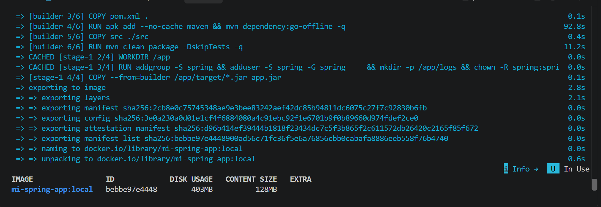
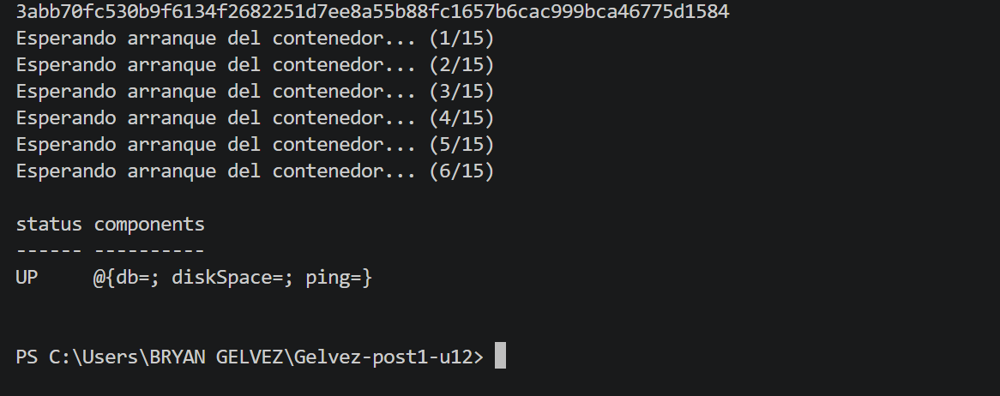
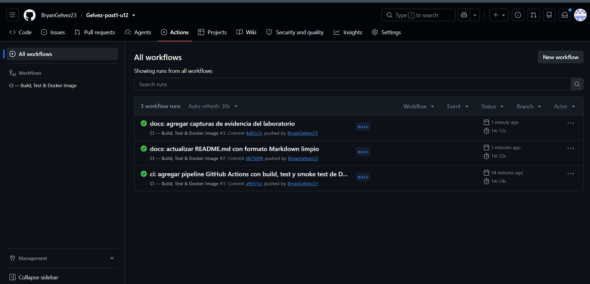
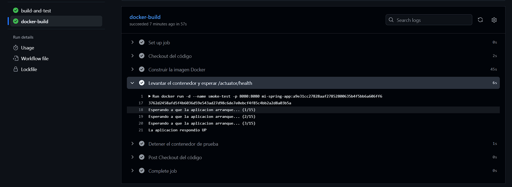
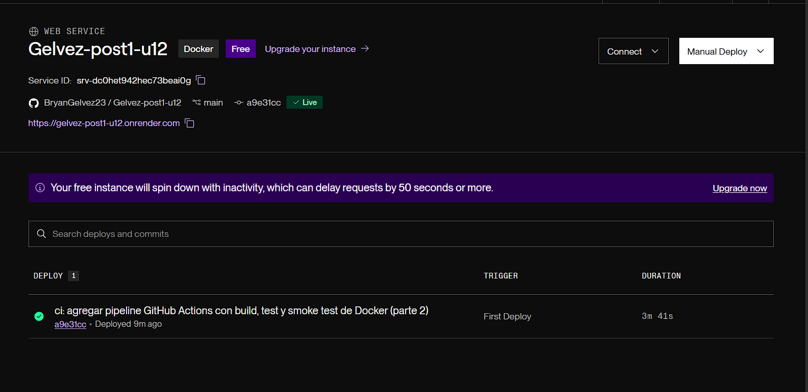
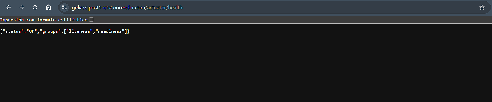

# Sistema de Gestión de Pedidos — Dockerización y CI/CD

[!CI — Build, Test & Docker Image](https://github.com/BryanGelvez23/Gelvez-post1-u12/actions/workflows/ci.yml/badge.svg)](https://github.com/BryanGelvez23/Gelvez-post1-u12/actions/workflows/ci.yml)

Aplicación Spring Boot 3.4 (Java 21) con arquitectura limpia y principios SOLID, empaquetada mediante un `Dockerfile` multi-stage, validada con un pipeline de integración continua en GitHub Actions y desplegada en Render.

- **URL pública en producción:** https://gelvez-post1-u12.onrender.com
- **Health check público:** https://gelvez-post1-u12.onrender.com/actuator/health

---

## 1. Construcción y ejecución local

### Requisitos previos
- Java 21 (JDK) y Maven 3.9+ (opcional si se compila únicamente dentro de Docker).
- Docker Desktop / Docker Engine en ejecución.

### Construcción de la imagen Docker
```bash
docker build -t mi-spring-app:local .
docker images mi-spring-app:local
```

### Ejecución en modo desarrollo (`dev`, valores por defecto con H2)
```bash
docker run -d --name mi-app-dev -p 8080:8080 mi-spring-app:local
curl http://localhost:8080/actuator/health
```

### Ejecución simulando producción (`prod`, variables externas)
```bash
docker run -d --name mi-app-prod -p 8080:8080 \
  -e SPRING_PROFILES_ACTIVE=prod \
  -e DATASOURCE_URL="jdbc:h2:mem:proddb;MODE=PostgreSQL" \
  -e DATASOURCE_DRIVER=org.h2.Driver \
  -e DATASOURCE_USER=appuser \
  -e DATASOURCE_PASSWORD=apppass \
  -e DDL_AUTO=create-drop \
  mi-spring-app:local
```

---

## 2. Arquitectura del pipeline CI/CD (`.github/workflows/ci.yml`)

El flujo automatizado se ejecuta en cada `push` y `pull_request` hacia la rama `main` mediante dos jobs encadenados:

1. **`build-and-test`**: descarga el repositorio, configura JDK 21 (Temurin) con caché de dependencias Maven, ejecuta `mvn clean verify` (compilación + pruebas de contexto con perfil `dev`) y publica los reportes de Surefire como artefacto.
2. **`docker-build`** (`needs: build-and-test`): construye la imagen Docker etiquetada con `${{ github.sha }}`, dvalida que /actuator/health responda "status":"UP" en un contenedor `smoke-test` y lo elimina al finalizar.

---

## 3. Decisiones de diseño

1. **Build multi-stage (`eclipse-temurin:21-jdk-alpine` → `21-jre-alpine`):** separa la etapa de compilación con Maven de la imagen final de ejecución, evitando incluir código fuente, caché `.m2` y herramientas de compilación en producción y manteniendo el tamaño de contenido en ~128 MB.
2. **Ordenamiento de capas (`pom.xml` antes de `src/`):** permite que Docker reutilice la capa de dependencias descargadas mientras no cambie el `pom.xml`, acelerando los builds posteriores.
3. **Usuario no root (`spring`) con directorio propio `/app/logs`:** reduce la superficie de ataque dentro del contenedor evitando ejecutar la JVM como `root` y otorga permisos explícitos de escritura para el archivo de logs configurado en Logback.
4. **Separación de perfiles (`dev` / `prod`) mediante placeholders `${VAR:default}`:** mantiene valores seguros por defecto para desarrollo local con H2 mientras permite inyectar credenciales, URL de base de datos y puerto (`${PORT:8080}`) en producción sin recompilar el artefacto niversionar secretos.
5. **Exposición diferenciada de Spring Boot Actuator:** en `dev` muestra el detalle completo de salud (`show-details=always`) y expone todos los endpoints para depuración; en `prod` restringe la exposición exclusivamente a `health` einfo con `show-details=never` para no filtrar información interna.
6. **Smoke test automatizado en GitHub Actions:** más allá de verificar que `docker build` termina sin errores, el job `docker-build` arranca el contenedor real y valida que Spring Boot inicialice correctamente y responda `UP` antes de dar por aprobado el commit.

---

## 4. Evidencias de funcionamiento

### Imagen Docker local (< 300 MB)


### Endpoint `/actuator/health` en local (perfil `dev`)


### Pipeline GitHub Actions (ejecuciones exitosas)


### Smoke test del contenedor en CI (`La aplicacion respondio UP`)


### Despliegue activo en Render


### Endpoint `/actuator/health` en producción (URL pública)

